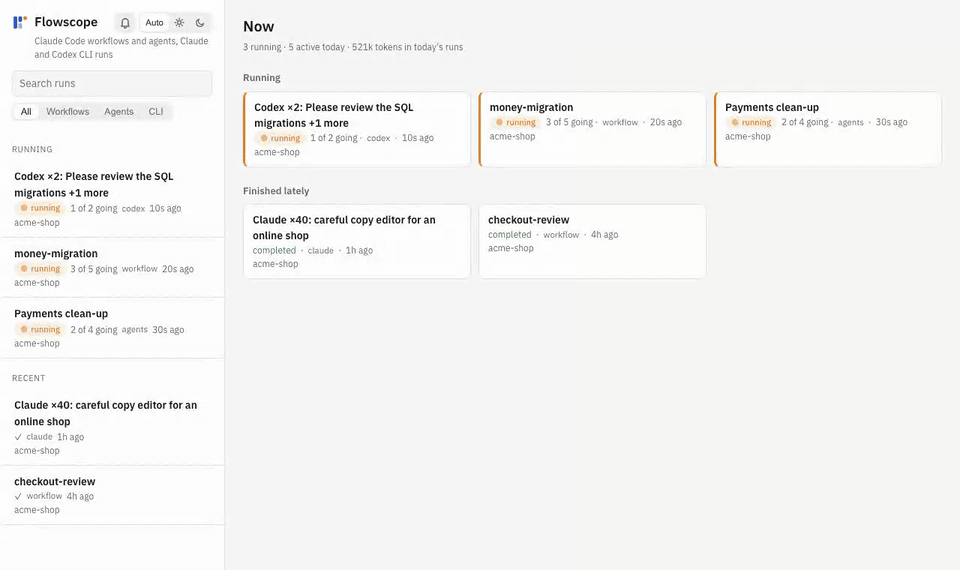
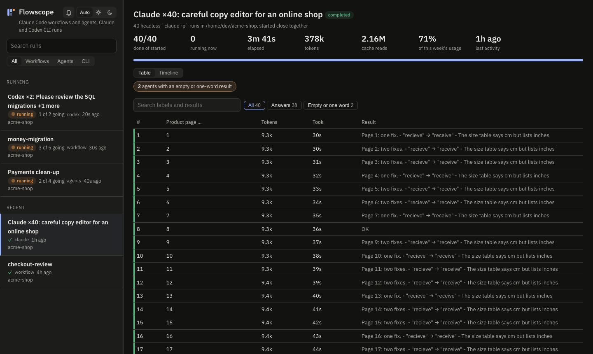
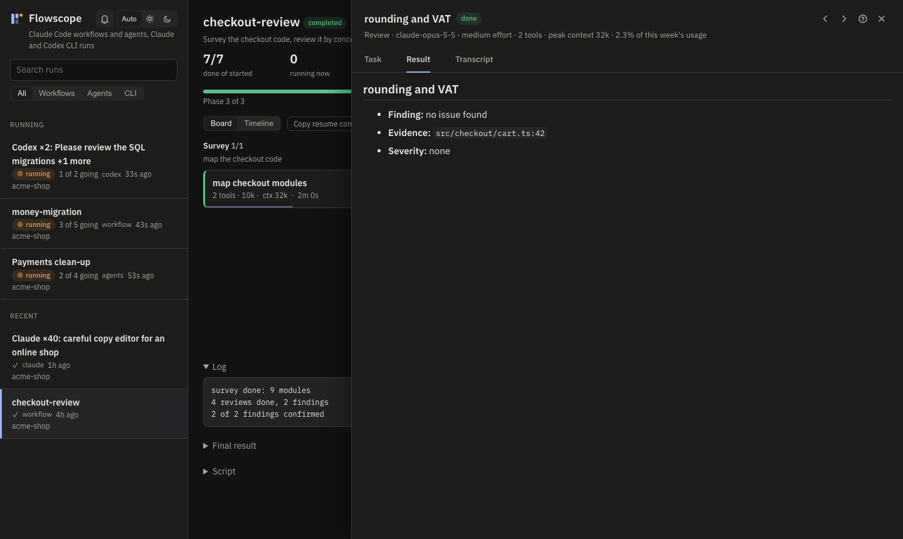
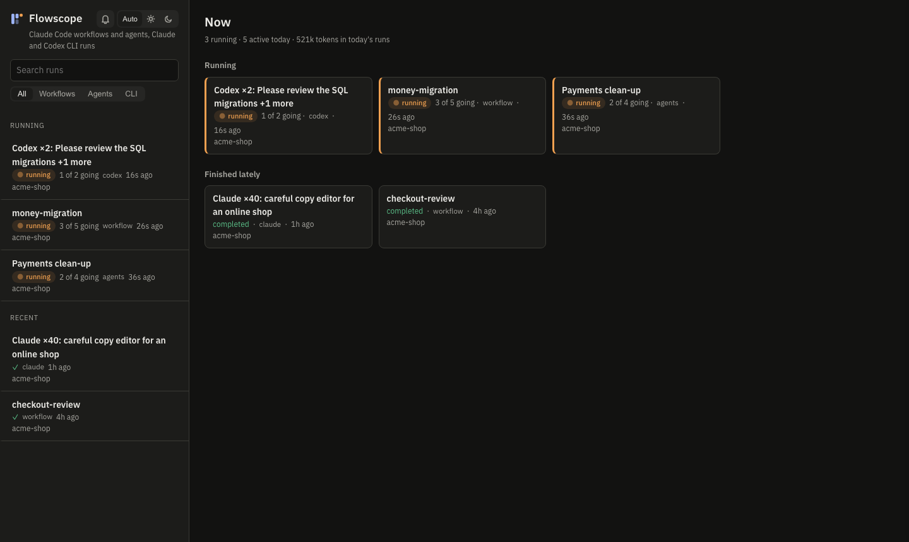
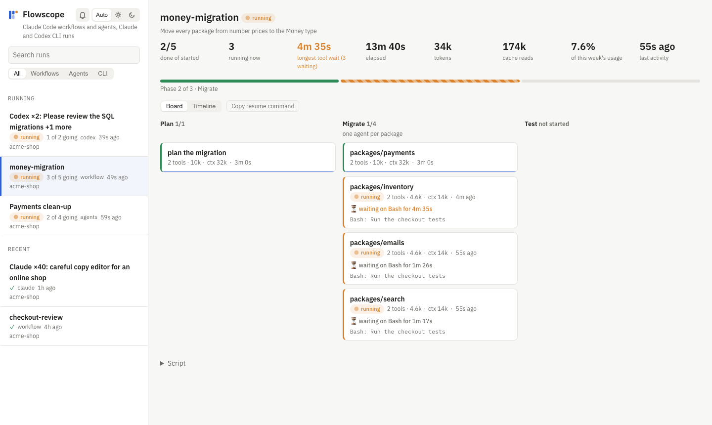

<p align="center">
  
</p>

<h1 align="center">Flowscope</h1>

<p align="center">
  <b>See what your AI agents are doing — live.</b><br>
  A local, read-only dashboard for Claude Code workflows, subagents, and headless <code>claude -p</code> / <code>codex exec</code> runs.
</p>

<p align="center">
  <a href="https://github.com/safarnejad/flowscope/actions/workflows/ci.yml"></a>
  <a href="LICENSE"></a>
  
  
  
</p>
<p align="center">
  <a href="SECURITY.md"></a>
  <a href="SECURITY.md"></a>
  <a href="SECURITY.md"></a>
  <a href="SECURITY.md"></a>
  <a href="SECURITY.md"></a>
  <a href="SECURITY.md"></a>
</p>

<p align="center">
  
</p>

You launched a workflow with 30 agents, or a script that fires 200 `claude -p` calls, and went back to work. Now: is it moving? Is one agent stuck on a test run? Did half of them hit the usage limit? What did agent 17 actually say?

The Claude Code extension shows little of this. **Flowscope reads the files Claude Code and Codex already write and turns them into a live board** — no hooks, no SDK, no setup, nothing sent anywhere.

```sh
git clone https://github.com/safarnejad/flowscope && cd flowscope
bun start        # serves http://127.0.0.1:4747 in the background and opens it
```

## What you get

**Watch it run**
- 🧭 **Every run on this machine, across projects** — workflows, a session's subagents, and batches of headless CLI runs — with status: `running`, `completed`, `failed`, `stopped`.
- 🗂️ **Phases as columns, agents as cards** — what each agent is doing *right now*, how long it has waited on a tool, its tool calls, tokens and peak context.
- ⏱️ **Timeline** — one lane per agent on a shared axis: what ran alongside what, and which agent held the run up. Long idle stretches are cut out so runs hours apart stay readable.
- 🔔 **Browser notifications** when a run finishes, fails, stops, or goes quiet for 10 minutes.

**Spot trouble fast**
- 🚨 **Needs a look** — agents silent for 10 minutes, stuck on a tool, stopped, ended on a usage limit (with its reset time), or that answered only "OK".
- 📊 **Big batches become a table** — 40 or 400 runs, one row each with the start of its answer, filters for *Answers / Empty or one word / Running / Stopped*, and search.

**Dig in**
- 📝 **Result and full transcript** for each agent: the task, every tool call with its input and output, rendered Markdown, highlighted code, JSON as tables, screenshots the agent saw.
- 🔎 **Search inside transcripts** — what agents said, were told, ran or got back.
- 🔗 **Deep links** to a run, an agent, or one step of a transcript.
- ▶️ **Copy resume command** — `claude --resume` / `codex resume`, already `cd`'d into the right folder.

**Count the cost**
- 💸 Tokens per run and per agent, and each run's **share of your last 7 days** of Claude Code usage, cost-weighted.

**Feels right**
- ⌨️ Keyboard first: `/` search, `j`/`k` next agent, `p`/`r`/`t` Task/Result/Transcript, `?` help.
- 🌗 Light and dark, 📱 works on a phone, 🔤 right-to-left text (Persian, Arabic) laid out properly.
- ⚡ Starts in about a second after the first run, thanks to an on-disk cache.

<table>
  <tr>
    <td></td>
    <td></td>
  </tr>
  <tr>
    <td align="center"><sub>40 headless runs, two of them answered only "OK"</sub></td>
    <td align="center"><sub>One agent's result, task and transcript</sub></td>
  </tr>
  <tr>
    <td></td>
    <td></td>
  </tr>
  <tr>
    <td align="center"><sub>Home: what is running now</sub></td>
    <td align="center"><sub>Light theme</sub></td>
  </tr>
</table>

<sub>Screenshots use made-up data from <code>bun run demo</code>.</sub>

## Private by design

Flowscope shows your prompts, code and tool output, so:

| | |
|---|---|
| 🔒 **Read-only** | Never writes to `~/.claude` or `~/.codex` (a test checks it byte for byte). Its only output is its own cache. |
| 🏠 **Local only** | Binds `127.0.0.1` and refuses any request not addressed to it, which blocks DNS rebinding. |
| 🛡️ **Hostile text stays inert** | Transcripts can hold text from any web page. Everything is escaped and sanitised, and a strict Content Security Policy stops injected markup from loading or sending anything. |
| 📦 **Zero runtime dependencies** | One TypeScript server and a page of plain HTML and JavaScript. Nothing to `npm install` to run it, nothing to audit but ~1,800 lines and three pinned, vendored libraries. |
| 📡 **No outbound requests** | No analytics, no update checks, no CDN. The page's libraries and fonts are vendored and served by Flowscope itself, with integrity hashes; it works offline. |

Details: [SECURITY.md](SECURITY.md).

## Install

Needs [Bun](https://bun.sh) 1.2 or later. macOS and Linux.

```sh
git clone https://github.com/safarnejad/flowscope && cd flowscope
bun start                 # start in the background and open the page
bun run stop              # stop it
```

To run it from anywhere, link it once:

```sh
bun link                  # in the flowscope folder
flowscope --open          # from any folder: start (once) and open
flowscope stop
```

Starting is idempotent: if Flowscope already answers on the port, it just says so. The link points at this folder, so a `git pull` takes effect without linking again.

| Option | Env | Default |
|---|---|---|
| `-p`, `--port` | `FLOWSCOPE_PORT` | `4747` |
| `-o`, `--open` | | off |
| `-f`, `--foreground` | | off |
| | `CLAUDE_PROJECTS_DIR` | `~/.claude/projects` |
| | `CODEX_SESSIONS_DIR` | `~/.codex/sessions` |
| | `FLOWSCOPE_CACHE` | `~/.claude/flowscope` |

The background server logs to `~/.claude/flowscope/flowscope.log`. Deleting that folder is always safe; the cache is rebuilt on the next start.

### Try it without any agents

```sh
bun run demo /tmp/flowscope-demo
CLAUDE_PROJECTS_DIR=/tmp/flowscope-demo/claude CODEX_SESSIONS_DIR=/tmp/flowscope-demo/codex \
  FLOWSCOPE_CACHE=/tmp/flowscope-demo/cache bun server.ts --foreground --open
```

## Reading the page

- **Left:** workflow runs and agent sessions together, most recently active first, filtered by the **All / Workflows / Agents / CLI** buttons (the choice is remembered). Each line shows its kind, status, agents finished out of started, and its share of the week's usage.
- **Top of a run:** agents done, agents running now, elapsed time, tokens (input, cache writes and output; hover for the split), cache reads, share of the week, last activity. The bar is agents done out of started.
- **Cards:** a coloured left edge for the state. A running agent shows its latest action, and `⏳ waiting on Bash for 2m` when a tool call has not returned yet.
- **Click a card:** a side panel with **Result** and **Transcript**. `Esc` closes it.
- **Link to a run:** the URL keeps the run id (`#wf_…`), so a reload returns to it.

### CLI runs

A script that calls `claude -p` or `codex exec` once per item leaves one session per call: Claude Code writes it under `~/.claude/projects` like any session but with the Agent SDK's system prompt, and Codex writes a rollout under `~/.codex/sessions` (override with `$CODEX_SESSIONS_DIR`) marked `codex_exec`. Flowscope puts runs of one tool, in one folder, whose prompts open the same way (first 300 characters), into one batch, and starts a new batch after a gap between starts: 30 minutes when the prompts open the same way, 10 otherwise ([R-T7, R-T8](docs/RULES.md#r-t-timing)). Each run is a card named by the last heading in its prompt (`# …` or `=== … ===`), which is usually the part that changes, such as `JUST HEARD (paragraph 12)`. A **live** Claude session, one a script keeps open and feeds a prompt per turn (`claude -p --input-format stream-json`), is one card named by its newest prompt's heading and its turn count, such as `JUST HEARD (paragraph 97) · 97 turns`. A Codex run is `done` when it logged `task_complete`; a Claude run is `done` when it ended on a text reply. A Codex batch shows `—` for share of the week, because Codex is billed separately.

### Status, and why it can lag

Claude Code writes a run's final record only when the run ends, so `completed` and `failed` are exact. Before that, Flowscope calls a run `running` while any of its files changed in the last **15 minutes**, and `stopped` after that. The window is long because an agent waiting on a long command writes nothing until the command returns. The cost: a run whose session was closed mid-way still shows `running` for up to 15 minutes.

When a workflow is resumed, agents from the earlier attempt that never finished show as `stopped`.

A plain subagent is `done` when its metadata says it finished, or when it handed its report back (a background agent calls `SubagentHandback`; a foreground one ends on a text reply) and has written nothing for 5 seconds. That handed-back report is its **Result**. A message sent to the agent afterwards (SendMessage) resumes it, so it is `running` again until it hands back a new report. Otherwise it is `running` within the 15-minute window and `stopped` after. A session's agent group is `running` while any of its agents is.

### Tokens and "share of the week"

Tokens are summed from each agent's transcript, counting each API message once.

Your plan's weekly limit is kept by Anthropic's servers and is not on disk, so Flowscope cannot show a percentage of the limit. It shows the run's share of **all** Claude Code usage on this machine in the last 7 days instead, weighted by API price ratios (input 1, cache write 1.25, cache read 0.1, output 5) as the closest local proxy for how usage counts. Usage on other machines or on claude.ai is not included.

## Where the data comes from

Claude Code and Codex do not document these files, so an update can change them. When Flowscope finds something it does not expect, it shows a warning instead of quietly wrong numbers. Every file and field it reads is listed in [docs/SOURCES.md](docs/SOURCES.md).

## API

The page uses these JSON endpoints, handy for scripts too (requests must be sent to `127.0.0.1` or `localhost`):

- `GET /api/runs`: all runs, summarised
- `GET /api/run?p=<project dir>&s=<session>&r=<runId>`: one run with phases and agents; `r=agents` gives the session's plain subagents, `r=cli` a CLI batch
- `GET /api/agent?p=…&s=…&r=…&a=<agentId>`: one agent's transcript as events
- `GET /api/search?q=<text>`: transcripts that contain the text
- `GET /api/format`: what in the input files looked unexpected
- `GET /api/pid`: the server's process id

Field-by-field shapes are in [docs/DATA.md](docs/DATA.md).

## Development

```sh
bun run dev               # restarts on server changes
bun test                  # end-to-end tests of the server against the demo data
bun run e2e               # browser tests of the page (bun install; bunx playwright install chromium)
bun run trace             # the docs and the tests agree; prints coverage
```

The docs are the specification and the code follows them: see [CONTRIBUTING.md](CONTRIBUTING.md).

- `server.ts` — the Bun server: finds runs, works out status and tokens, serves the API and the page
- `public/index.html`, `public/app.js`, `public/theme.js` — the whole page (no build step); `public/vendor/` — marked, DOMPurify, highlight.js and IBM Plex, vendored
- `scripts/demo.ts` — writes the made-up data used by the tests and screenshots
- `scripts/tour.ts` — records the tour GIF above from that data (`bun scripts/tour.ts`; needs ffmpeg)
- `test/server.test.ts` — the end-to-end tests, each named by the F-/R- ids it checks
- `scripts/trace.ts` — checks that docs and tests agree

### Design documents

- [docs/ARCHITECTURE.md](docs/ARCHITECTURE.md) — what the server works out (status, tokens, batches, caching, security) and why
- [docs/SOURCES.md](docs/SOURCES.md) — every input file and field read
- [docs/DATA.md](docs/DATA.md) — API shapes and where each field shows on the page
- [docs/FLOWS.md](docs/FLOWS.md) — user flows as checks with ids, and the test that covers each
- [docs/RULES.md](docs/RULES.md) — every constant, threshold and limit
- [CONTRIBUTING.md](CONTRIBUTING.md) — docs as the source of truth, the id scheme, running tests and trace
- [docs/UX.md](docs/UX.md) — the interface design

## License

[MIT](LICENSE).

Flowscope is an independent project. It is not affiliated with, endorsed by, or supported by Anthropic or OpenAI. "Claude" and "Claude Code" are trademarks of Anthropic; "Codex" is a trademark of OpenAI.
